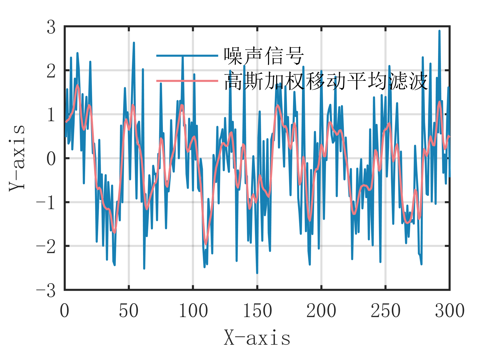

# MATLAB | Digital Signal Processing | Gaussian Weighted Moving Average Filtering Algorithm | Includes data and plotting code | Directly Useable

1. Basic Definition
The Gaussian Weighted Moving Average Filtering algorithm is a filtering method based on weighted averages, which can effectively remove Gaussian noise while preserving the main characteristics of the signal. The main idea of this algorithm is to eliminate noise by averaging the signal with weights calculated according to the Gaussian distribution, where the closer to the center point the weight value is, the larger it is, and the farther away from the center point the weight value is, the smaller it is. This approach reduces the impact of noise while retaining the main characteristics of the signal. Specifically, the steps of the Gaussian Weighted Moving Average Filtering algorithm are as follows:
- Define a filtering window that includes the current sample point and several surrounding points.
- Calculate the weight for each point within the window, based on the Gaussian distribution, with points further away from the current sample point having smaller weights.
- Perform a weighted average of the values of each point within the window, obtaining the filtered result for the current sample point.
- Move the filtering window forward one position and repeat the above steps until all sample points have been processed. The advantage of the Gaussian Weighted Moving Average Filtering algorithm is its ability to effectively remove Gaussian noise while retaining the main characteristics of the signal; however, it requires selecting an appropriate window size and Gaussian distribution parameters, as improper selection may affect the filtering effect.
2. Definition and Outline Effects
The outlining effects are as follows:
\n        \n  
Attach video tutorial operation:
\n        \n          \n          \n          \n          \n            To view this video please enable JavaScript, and consider upgrading to a\n            web browser that\n            supports HTML5 video\n

## Images

<!-- PAYMENT_BLOCK -->

## Get this dataset

- Payment link (Stripe): [Buy now](https://buy.stripe.com/3cs8yP7sY87d0vu9AB)
- Payment QR code: 

<!-- /PAYMENT_BLOCK -->
